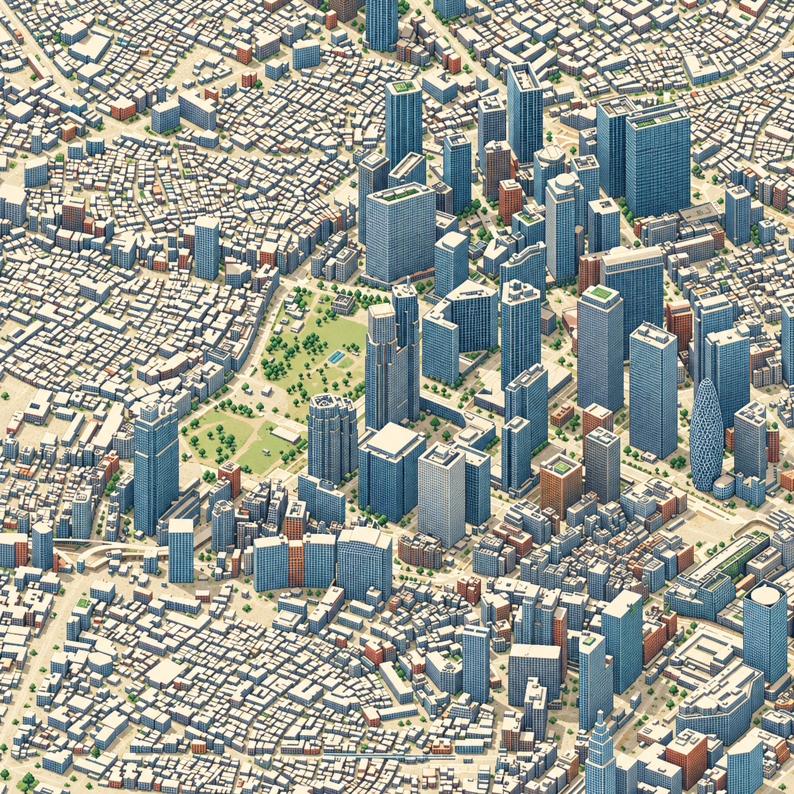
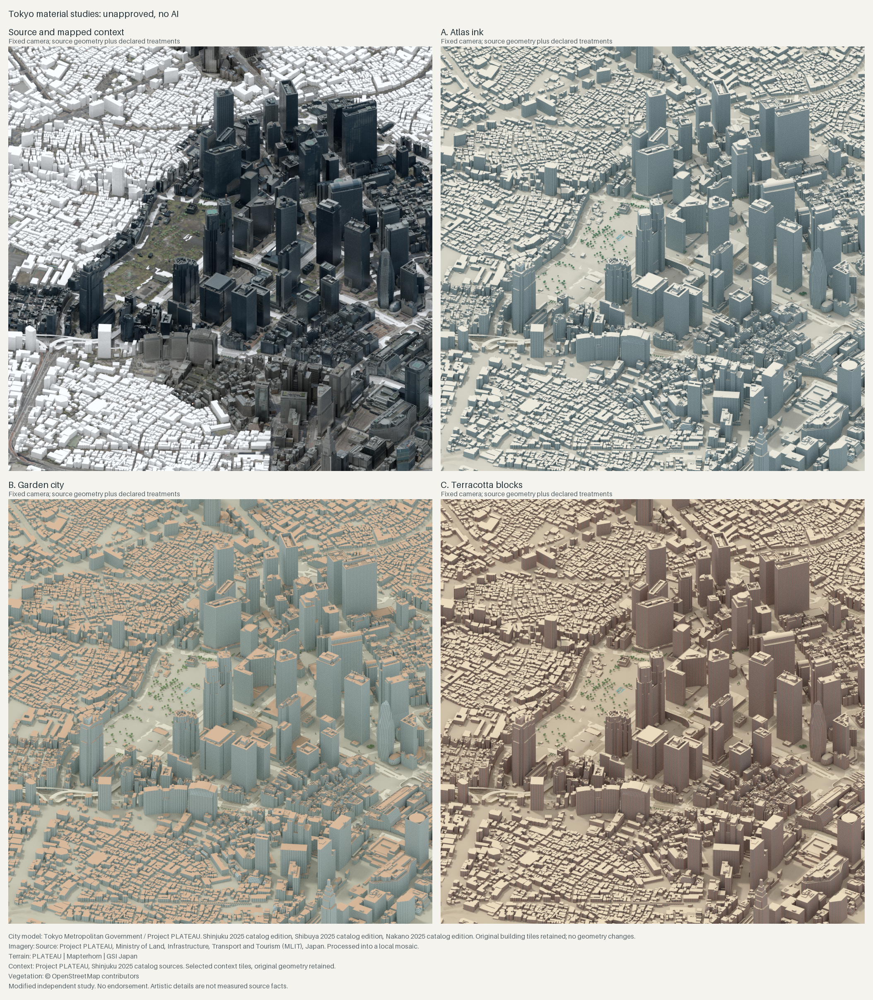
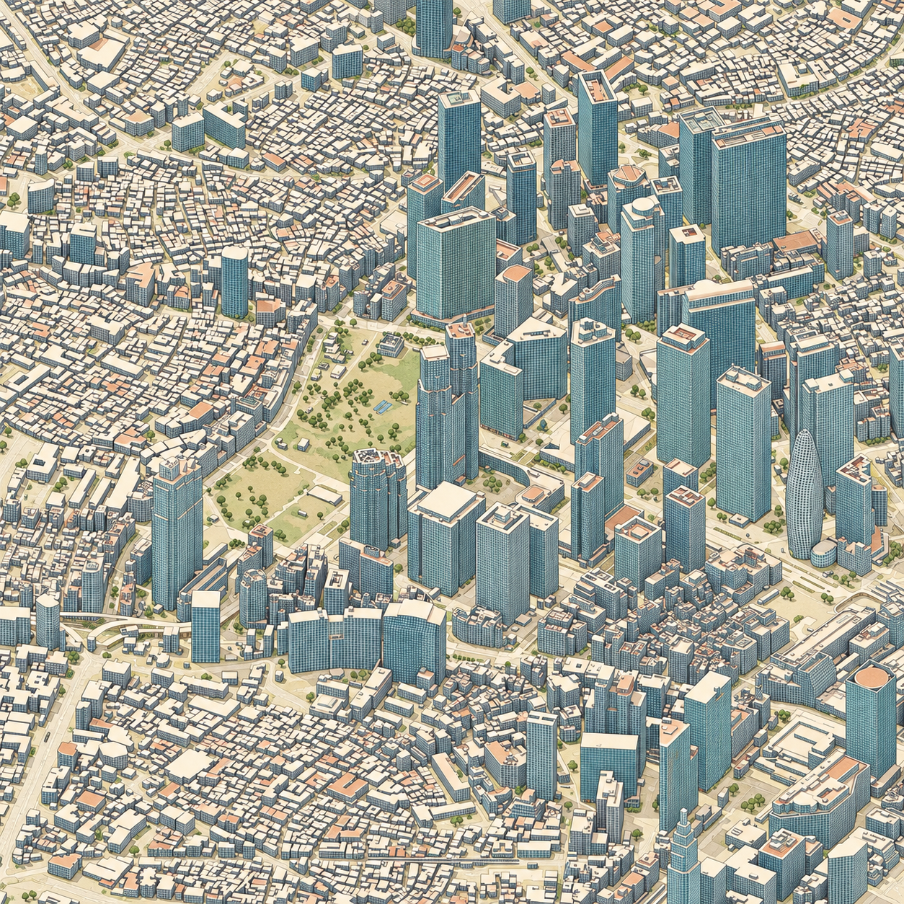

# isometric.tokyo

An independent illustrated isometric map of Tokyo in development, using open
Project PLATEAU data. The goal is a continuous, explorable map in the same product
category as [isometric.nyc](https://isometric.nyc/), with original Tokyo artwork.

**Current state:** a native **3072 × 3072 Pixel city pilot** of Shinjuku, assembled
from nine 1024 × 1024 artwork cores. Nine separate native 1254 × 1254 generations
supply the initial exact crops; bounded repairs address details found during
review through recorded exact overwrites, not upscaling or blending. This adds
detail to the same bounded source view, not more geography or a completed district.
All 12 internal joins and four junctions passed recorded visual review after one
bounded rooftop repair. Source comparison remains approximate, not geographic approval.

The full-screen viewer keeps a compact toolbar, source access and shareable
positions. Switching the native pilot's Source/Pixel city layers preserves framing,
not pixel registration or geographic accuracy. Fine facade, roof, planting and
park-path details are artistic. Geographic fidelity and production artwork remain
unapproved. See [pilot results and downloads](docs/NATIVE_PILOT_RESULTS.md)
and [the native pilot workflow](docs/NATIVE_PILOT.md).

A [5 × 5 expansion workflow](docs/NATIVE_EXPANSION.md) adds sixteen neighboring
cores at the same native scale, retaining the accepted pilot artwork and stable
map coordinates. Its new source, artwork and reviews must pass before it becomes
the selected map. This is a bounded next batch, not complete Shinjuku coverage.



*The image above is the earlier 1254-pixel direction study, not the new nine-core
atlas. It remains the committed quick-start preview.*

Derived from Tokyo Metropolitan Government / Project PLATEAU, Shinjuku, Shibuya
and Nakano FY2025, and PLATEAU-Ortho 2023.
Terrain: **PLATEAU | Mapterhorn | 国土地理院**.
Vegetation: **© OpenStreetMap contributors**, ODbL.
Selected, transformed and rendered, then AI-styled. Roofs, planting, surfaces
and other details may differ from the source.
Independent project, not an official product or endorsement.
See [source terms and full attribution](THIRD_PARTY_NOTICES.md).

## What is here

- A bounded Shinjuku view around the Tokyo Metropolitan Government buildings.
- Scripts to download bounded building, orthophoto, terrain, road and water samples.
- A browser viewer with pan/zoom, touch and keyboard controls, an overview map
  and shareable views. The native pilot has shared-framing Source/Pixel city
  layers with explicit accuracy limits. The historical art preview has independent
  coordinates; the earlier source/geometry atlas retains aligned comparison.
- Native source rendering, nine-window AI-output ingestion and hash-bound manual
  seam/source review before export. Generation itself is an external step.
- Content-addressed image versions and verified, self-contained web bundles.
- Pixel-aligned Blender chunk rendering, verified against full-view references.
- Original building/context feature-ID, semantic, silhouette, depth and normal guides.
- Bounded-memory image pyramids with selective rebuilding.
- Resumable render jobs, a local review desk, seam regions and immutable repair candidates.
- [Geometry-only comparison](previews/shinjuku-geometry.png).
- Offline tests, source checksums, browser tests and saved-scene verification.
- A verified metadata inventory for all 23 wards, with explicit source-quality gaps.
- [The phased implementation roadmap](docs/PLAN.md), from the source study to a
  seamless illustrated atlas and interactive Tokyo map.
- [Detailed source-quality notes and provenance](README.txt).

Landmark geometry is useful, but some smaller buildings are untextured. The
original source atlas has photographic vegetation only. New studies supplement
it with separately attributed mapped tree points and woodland representations,
not a claimed tree survey. Source dates and LOD vary.
The FY2025 dataset edition does not mean that all photography was taken in 2025.

## Shinjuku art direction



Source and mapped context compared with **Atlas ink**, **Garden city** and
**Terracotta blocks**. Same camera and source geometry, with artistic facade
marks, palettes and canopy representations. These are geometry-preserving
material studies, not final illustrations or approvals.

City model: Tokyo Metropolitan Government / Project PLATEAU. Imagery:
PLATEAU-Ortho 2023. Terrain: **PLATEAU | Mapterhorn | 国土地理院**.
Vegetation: **© OpenStreetMap contributors**, ODbL. Modified by this independent
project. The [derived vegetation database](datasets/shinjuku-vegetation/README.txt)
and [full source terms](THIRD_PARTY_NOTICES.md) accompany the preview.
See [art-direction notes](docs/STYLE_PILOT.md), [coverage audit](docs/COVERAGE.md)
and [vegetation evidence](docs/VEGETATION.md) before interpreting detail as measured.

Two separate AI-assisted treatments explore a more illustrated result:

| D. Pixel city | E. Printed atlas |
| --- | --- |
|  |  |

Both retain a recognizable composition but redraw details and building edges.
Pixel city adds green roofs and planting not established by the source. Neither
is a geometry-accurate comparison layer or approved artwork. Source credits and
terms above still apply. [Prompts, provenance and limitations](previews/shinjuku-art/ai-studies.json)
are retained. The historical `preview-dev` study opens Pixel city by default and
keeps its differently sized source render as a distinct view. That study resets
framing on view changes. The new native pilot instead uses a shared 3072-pixel
frame, while explicitly rejecting any claim of pixel-level geographic registration.

## Roadmap

The [implementation plan](docs/PLAN.md) covers the full path: a tiled Shinjuku
viewer, seamless geographic rendering, an approved art direction, production and
review tools, a complete illustrated district, then connected expansion toward
Tokyo's 23 special wards. Each phase has deliverables and acceptance criteria.
The current sample is the baseline, not the completed product.

## Explore the studies and native pilot

Requirements: Python 3.11+, Node.js 26, `just` and `uv`. Blender 5.2 is needed only
for new geographic renders and scene checks, not for the viewer. No PLATEAU
account or API key is required for these sources.

```sh
just bootstrap
export PYTHON="$PWD/.venv/bin/python"
just check
just preview-dev
```

This quick start opens the **historical 1254-pixel art study**, not the new native
pilot. The preview task builds verified tiles from the attributed previews already
in this repository, without new geographic downloads or image generation.
It prints the local development address; it does not open a browser automatically. Original PNGs remain available from the map credits.

```sh
just viewer-browsers
just viewer-e2e
just preview-package
just preview-verify
```

The immutable bundle contains the app, selected image version, source evidence,
licences and ODbL data. `just viewer-dev` still opens the earlier aligned
source/geometry atlas. No development command opens a browser automatically.

The native pilot requires its generated artwork and completed review records,
which are not recreated by the quick start. After following
[the source, generation and review workflow](docs/NATIVE_PILOT.md):

```sh
just map-tiles renders/pixel-city-pilot-v1/render-index.json \
  configs/shinjuku-pilot-source.json renders/pixel-city-pilot-v1/evidence.json
just map-verify
just map-dev
# In a separate terminal, when ready to build an immutable artifact:
just map-package
```

`map-*` tasks verify the selected native pilot and never rebuild the old art
study. `preview-*` tasks select that historical study instead. See
[release formats and version selection](docs/PREVIEW_RELEASE.md) before switching
between them. Building an artifact is not a claim that it has been published.

## Reproduce geographic renders

```sh
just fetch
just ground
just terrain
just render
just verify
just verify-scene
just previews
```

Generated files default to `renders/`. Override with `OUTPUT_DIR` or
`just --set out /path/to/output render`. Downloads are cached under `data/`;
tool caches stay under `.cache/`. Source services may change after this snapshot.

`just check` runs Python, viewer and review-tool lints and unit tests without
geographic downloads or Blender. Install development dependencies first. The
first Ruff invocation needs network access; `UV_OFFLINE=true` works once the
pinned tool is cached. `just package` produces a source kit after a sample render.
Large source files, generated tile trees and Blender projects are not in Git.

For the new pipeline:

```sh
just atlas-plan
just seam-check
just atlas-batch
just chunk-tiles renders/batch-shinjuku/render-index.json renders/shinjuku-tiles
just viewer-dev-chunks renders/batch-shinjuku/render-index.json
just review
```

The batch runner resumes without repeating completed jobs and leaves output
awaiting review. See [rendering and guide layers](docs/RENDERING.md),
[production jobs](docs/PRODUCTION.md), [review controls](docs/REVIEW.md),
[sparse pyramids](docs/CHUNK_PYRAMID.md), [seam review and repairs](docs/REPAIR.md),
[source inventory](docs/SOURCE_INVENTORY.md)
and [current implementation status](docs/PROGRESS.md).
