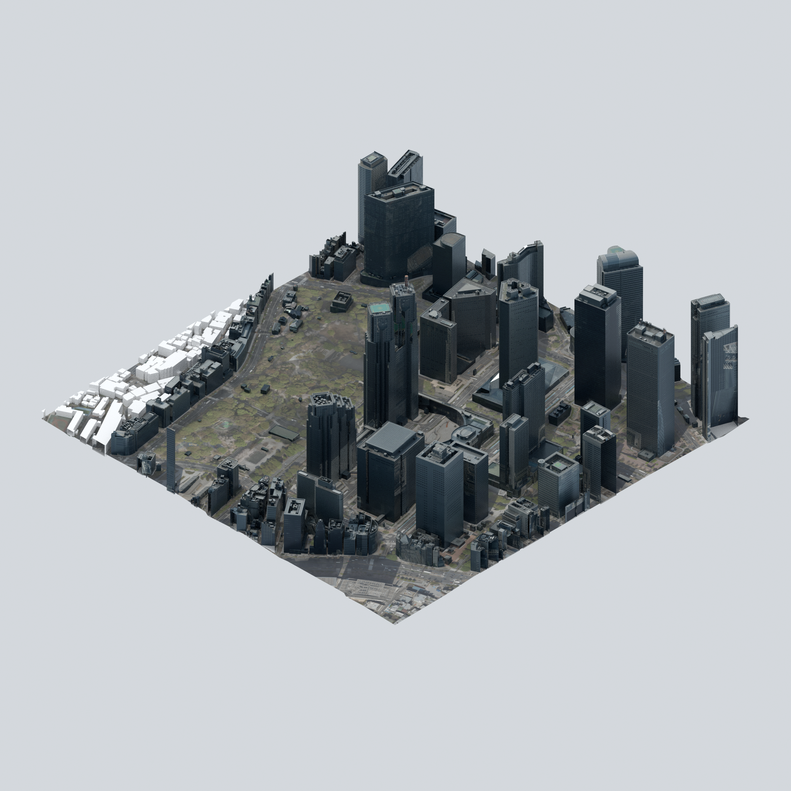

# isometric.tokyo

An independent isometric Tokyo map experiment using open Project PLATEAU data.

**Current state:** a reproducible, unstyled Shinjuku source-quality study. The
interactive viewer and Kubernetes deployment are planned, not implemented.



Derived from Tokyo Metropolitan Government / Project PLATEAU, Shinjuku FY2025,
and PLATEAU-Ortho 2023. Terrain: **PLATEAU | Mapterhorn | 国土地理院**.
Selected, transformed, cropped and rendered by this project. No AI styling.
Independent project, not an official product or endorsement.
See [source terms and full attribution](THIRD_PARTY_NOTICES.md).

## What is here

- A roughly 800 × 800 metre sample around the Tokyo Metropolitan Government buildings.
- Scripts to download bounded building, orthophoto and terrain samples.
- Blender rendering with a fixed orthographic isometric camera.
- [Geometry-only comparison](previews/shinjuku-geometry.png).
- Offline tests, source checksums and saved-scene verification.
- [The phased proof-of-concept plan](docs/PLAN.md).
- [Detailed source-quality notes and provenance](README.txt).

Landmark geometry is useful, but some smaller buildings are untextured. Trees are
currently ground photography, not 3D vegetation. Source dates and LOD vary.
The FY2025 dataset edition does not mean that all photography was taken in 2025.

## Reproduce

Requirements: Python 3.11+, Pillow, `just`, `uv`, and Blender 5.2 on `PATH`.
Blender is needed only for rendering and saved-scene checks. `uvx` supplies the
pinned Ruff version. No PLATEAU account or API key is required for these sources.

```sh
uv venv
uv pip install -r requirements.txt
export PYTHON="$PWD/.venv/bin/python"
just check
just fetch
just ground
just terrain
just render
just verify
just verify-scene
just previews
```

Generated files default to `renders/`. Override with `OUTPUT_DIR` or
`just --set out /path/to/output render`. Downloads are cached under `data/`;
tool caches stay under `.cache/`. Source services may change after this snapshot.

`just check` runs offline unit tests and lints without downloaded geographic data
or Blender. The first Ruff invocation needs network access; `UV_OFFLINE=true`
works once the pinned tool is cached. `just package` produces a local source kit
after a successful render. Large source files and Blender projects are not in Git.

## Public repository boundaries

This repository contains original scripts, tests, documentation and attributed
render previews. It contains no cluster access, DNS tokens, private deployment
overlays, lab endpoints or personal filesystem paths. Preview export removes
renderer metadata that can expose local filenames without changing image pixels.

Original project code is licensed under the [MIT License](LICENSE).
This does not relicense PLATEAU data, aerial imagery, terrain or derived previews;
those retain their [separate upstream terms](THIRD_PARTY_NOTICES.md).
